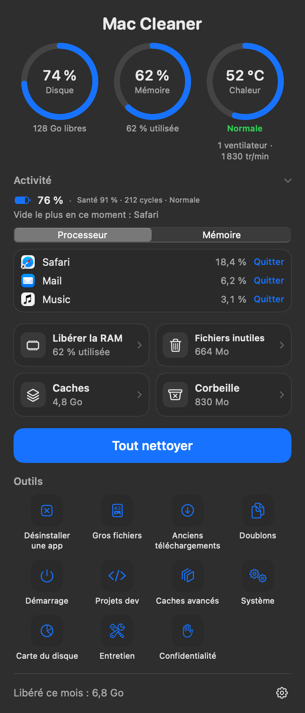
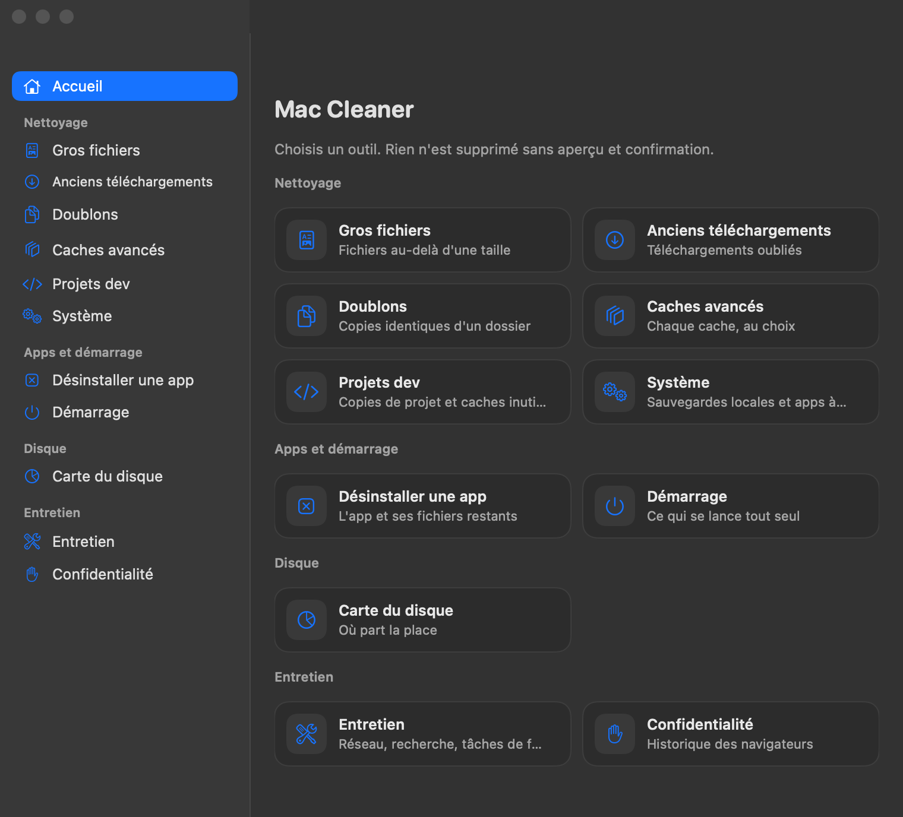

# Mac Cleaner

A free, lightweight macOS menu bar app to keep an eye on your Mac and clean it safely. Version 0.1, the first public release.

<p>
  
  
</p>

## What it does

- **Panel**: disk space, memory, heat (sensors adapted to the chip) and fans at a glance.
- **Shortcuts**: free RAM, junk files, caches, Trash, or clean everything in one click.
- **Tools**: uninstall apps with their leftovers, large files, old downloads, duplicates, login items, developer projects, advanced caches, system cleanup, disk map, maintenance, privacy.
- **Alerts** when the disk fills up or the Mac runs hot, resource-hungry apps, battery health, optional weekly clean.
- **Preview before any deletion**: nothing is removed until you have seen the list and confirmed.

Cleaning is done by the [mac-cleaner](https://github.com/iberis-suite/mac-cleaner) CLI, embedded in the app: nothing else to install.

## Install

```sh
brew install --cask iberis-suite/tap/mac-cleaner-app
```

If Homebrew asks you to trust the tap first: `brew trust iberis-suite/tap`, then run the install again.

macOS 13 Ventura or later.

## Build

```sh
git clone https://github.com/iberis-suite/mac-cleaner
git clone https://github.com/iberis-suite/mac-cleaner-app
cd mac-cleaner-app && ./build.sh
```

`build.sh` embeds the CLI from `../mac-cleaner/mac-cleaner` (or `MAC_CLEANER_CLI_SRC`), signs with a Developer ID identity if one is in the keychain (ad hoc otherwise) and produces `build/Mac Cleaner.app` and `build/MacCleaner-<version>.zip`.

## License

MIT, see [LICENSE](LICENSE).

---

# Mac Cleaner (français)

Application gratuite et légère pour la barre des menus macOS : surveiller son Mac et le nettoyer sans risque. Version 0.1, première version publique.

## Ce qu'elle fait

- **Panneau** : espace disque, mémoire, chaleur (capteurs selon la puce) et ventilateurs d'un coup d'œil.
- **Raccourcis** : libérer la RAM, fichiers inutiles, caches, corbeille, ou tout nettoyer en un clic.
- **Outils** : désinstaller une app et ses restes, gros fichiers, anciens téléchargements, doublons, éléments au démarrage, projets de développement, caches avancés, système, carte du disque, entretien, confidentialité.
- **Alertes** disque plein ou Mac trop chaud, apps gourmandes, santé de la batterie, nettoyage hebdomadaire facultatif.
- **Aperçu avant toute suppression** : rien n'est supprimé avant que vous ayez vu la liste et confirmé.

Le nettoyage est fait par le CLI [mac-cleaner](https://github.com/iberis-suite/mac-cleaner), embarqué dans l'app : rien d'autre à installer.

## Installation

```sh
brew install --cask iberis-suite/tap/mac-cleaner-app
```

Si Homebrew demande d'abord de faire confiance au tap : `brew trust iberis-suite/tap`, puis relancer l'installation.

macOS 13 Ventura ou plus récent.

## Compilation

```sh
git clone https://github.com/iberis-suite/mac-cleaner
git clone https://github.com/iberis-suite/mac-cleaner-app
cd mac-cleaner-app && ./build.sh
```

`build.sh` embarque le CLI depuis `../mac-cleaner/mac-cleaner` (ou `MAC_CLEANER_CLI_SRC`), signe avec une identité Developer ID si le trousseau en contient une (ad hoc sinon) et produit `build/Mac Cleaner.app` et `build/MacCleaner-<version>.zip`.

## Licence

MIT, voir [LICENSE](LICENSE).
